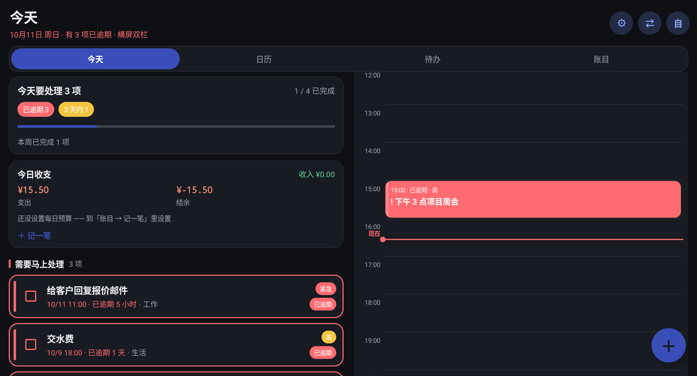
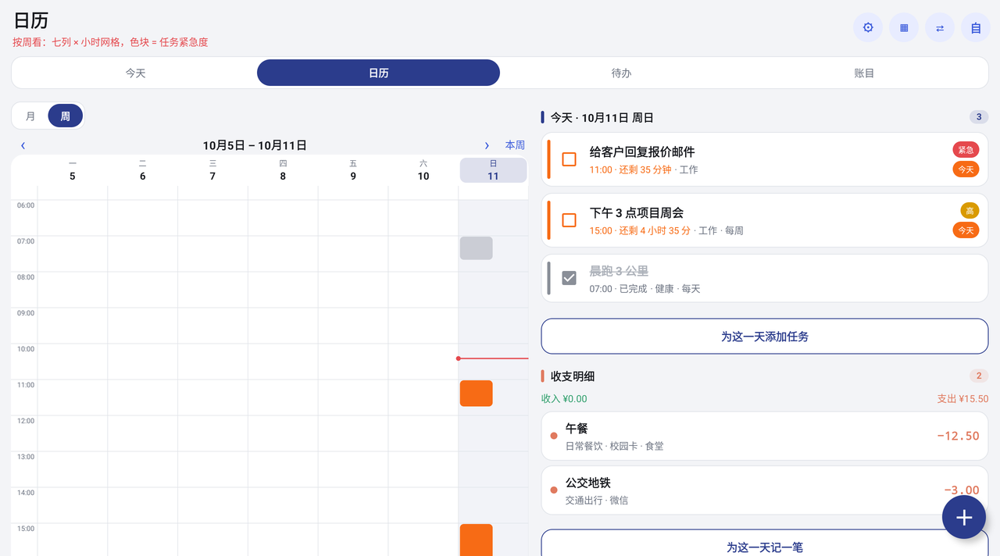
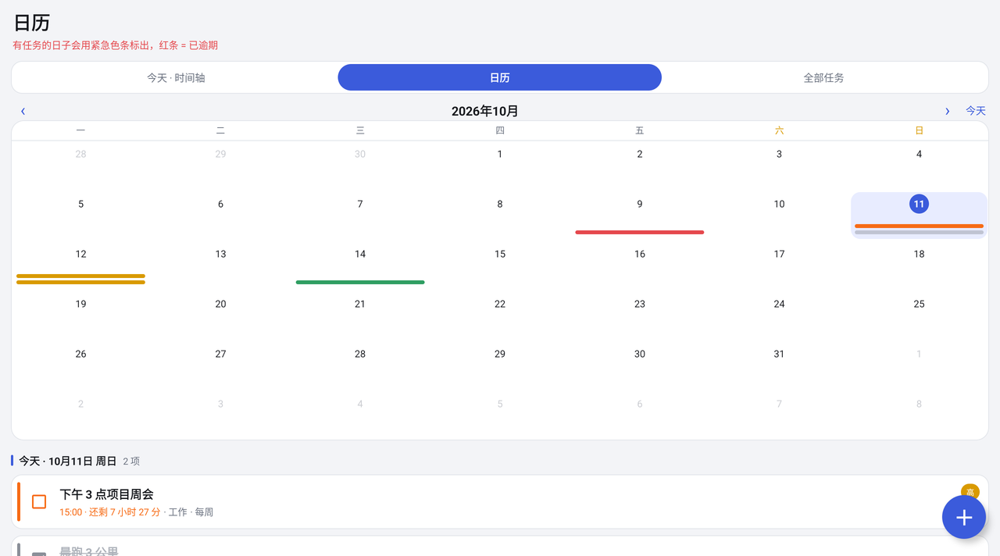
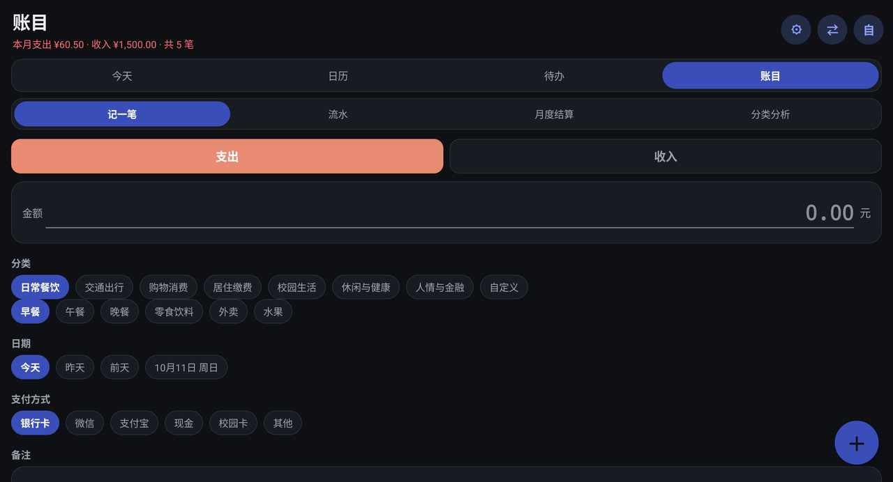
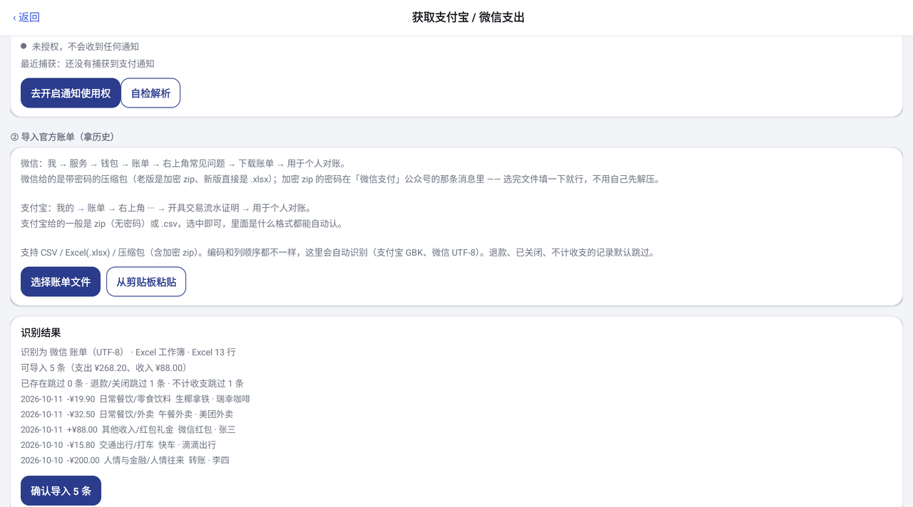
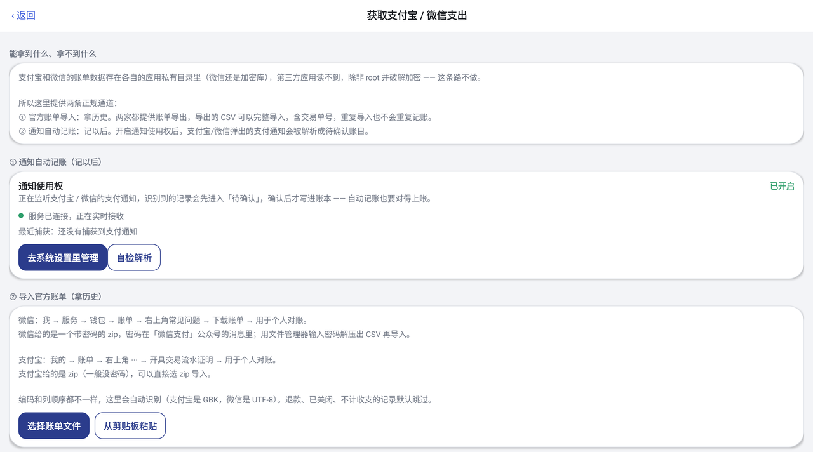
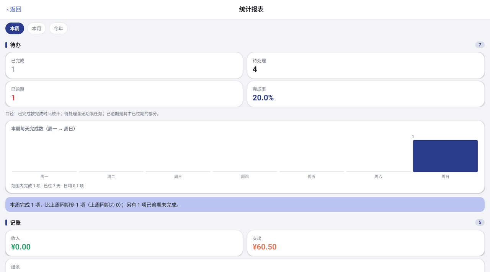
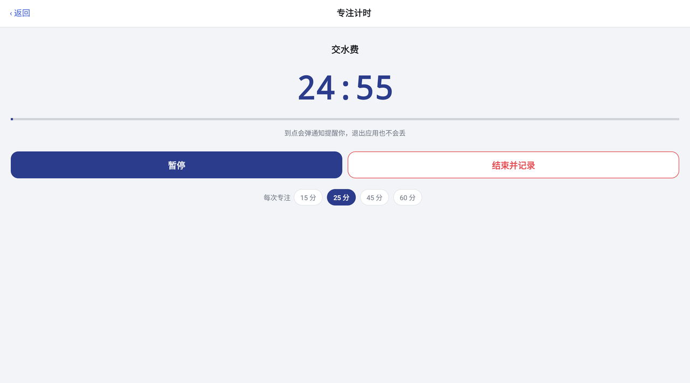
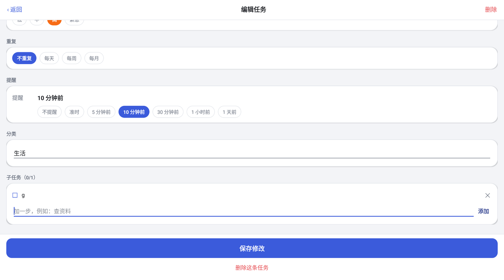

# SudfryTodo

**一个 Android 应用，把「待办」和「记账」放进同一个时间轴里。**

日程和钱本来是同一件事的两面 —— 今天要干什么、今天花了多少。
SudfryTodo 把它们并排放在一个页面：左边是今天的任务，右边是今天的收支。
没有账号、没有云端、没有广告，数据只存在你自己的手机上。

`Android 8.0+` · `纯 Java · 无 AndroidX` · `APK 约 190 KB` · `完全离线`



---

## 目录

- [它能做什么](#它能做什么)
- [截图](#截图)
- [构建与安装](#构建与安装)
- [设计上的一些取舍](#设计上的一些取舍)
- [技术文档](#技术文档)
  - [四个标签页](#四个标签页)
  - [待办](#待办)
  - [记账](#记账)
  - [自动获取支付宝 / 微信支出](#自动获取支付宝--微信支出)
  - [设置与外观](#设置与外观)
  - [数据与备份](#数据与备份)
  - [源码结构](#源码结构)
  - [实测情况](#实测情况)
  - [已知限制](#已知限制)
  - [版本历史](#版本历史)

---

## 它能做什么

| | |
|---|---|
| **待办** | 时间轴 + 月/周日历 + 四象限矩阵；紧急度五档配色贯穿全应用；自然语言录入、长按拖动排期、子任务、番茄钟 |
| **记账** | 记一笔 / 流水 / 月度结算 / 分类分析；每日预算；二级分类体系（对齐《日簿 · 收支管理》） |
| **自动入账** | 支付宝、微信**官方账单导入**（CSV / zip / **新版 .xlsx** / **带密码的 zip**）+ **通知使用权自动记账** |
| **数据** | 本地 JSON 存储；自动备份（间隔可调、只留最近 12 份）；文件 / 剪贴板 / **同一 Wi-Fi 局域网直传** |
| **外观** | 浅色 / 深色、主题色色相+饱和度滑块、4 套紧急度配色（含**色盲友好**）、3 套整体风格（圆润 / 标准 / 方正） |

一句话分工：**账单导入拿历史，通知监听记以后，两者都进「待确认」让你过一眼。**

---

## 截图

| 待办 · 今天 | 日历 · 周视图 | 日历 · 月视图 |
|---|---|---|
|  |  |  |

| 记账 · 记一笔 | 账单导入 | 通知自动记账 |
|---|---|---|
|  |  |  |

| 统计报表 | 专注计时 | 子任务 |
|---|---|---|
|  |  |  |

---

## 构建与安装

**直接安装**：下载 [`dist/SudfryTodo-v1.5.1.apk`](dist/SudfryTodo-v1.5.1.apk)（约 190 KB），
传到手机上点开安装即可（系统里需要允许「安装未知来源应用」）。覆盖安装旧版本不会丢数据。

想自己从源码构建，需求：**JDK 21**、**Android SDK**（`platforms;android-34`、`build-tools;35.0.1`）。

```powershell
python tools\build_todo.py          # → dist/SudfryTodo-v1.5.1.apk（约 190 KB）
python tools\build_fakepay.py       # 伪造微信/支付宝包名的测试应用（验证通知链路）
python tools\make_bill_samples.py   # 生成两份真实格式的账单样例（GBK / UTF-8-BOM）
```

不依赖 Gradle、不依赖 AndroidX，直接用命令行工具链构建：

```
aapt2 compile → aapt2 link → javac → d8 → zipalign → apksigner
```

- 包名 `com.sudfry.todo`，最低 **Android 8.0（API 26）**，目标 **Android 14（API 34）**
- 构建脚本自动找 SDK：先看 `ANDROID_SDK_ROOT` / `ANDROID_HOME`，再找仓库下的 `_sdk`，
  最后找 `%LOCALAPPDATA%\Android\Sdk`；JDK 用 `JAVA_HOME`
- `tools/todo.jks` 不随仓库发布，首次构建会自动生成一把新的签名密钥。
  也就是说**自己重新构建出来的 APK 和 `dist/` 里那个的签名不同**，装了发布版的设备要先卸载再装
- 覆盖安装旧版本即可，数据（`todos.json` / `entries.json`）自动保留并兼容
- iOS / iPad 用单文件网页版：[`ios/SudfryTodo.html`](ios/SudfryTodo.html)，Safari 打开 → 添加到主屏幕，
  **导出 / 导入格式与 Android 版互通**

---

## 设计上的一些取舍

这些是有意为之，不是没做完：

- **不做无障碍抓屏**。技术上可行，但要模拟点击去读支付宝/微信的界面，极不稳定、会被风控拦，
  而且等于把这些应用的屏幕内容全部交出去。所以只走**官方账单导入**和**通知使用权**两条正规通道。
- **通知自动记账不直接入账**，而是进「待确认」列表。一条通知只有一段文本，
  金额和方向能确定，**分类是猜的** —— 猜的东西就该让人过一眼。
- **主题色和紧急度配色分成两层**，互不干涉。主题色只管按钮、选中态；
  红/橙/黄/绿/灰这五档是固定语义色，否则「哪件事最急」这个核心信息就被换肤换没了。
- **删除都能撤销**，账目也是；**每次导入打批次号**，导错了一键撤销这一批。
- **写盘前先留 `.bak`**，写入本身是「临时文件 + rename」的原子替换。

---

# 技术文档

> 以下部分写给要看实现的人。功能怎么用、为什么这么设计、踩过哪些坑，都在里面。

## 四个标签页

| 标签 | 内容 |
|---|---|
| **今天** | 待办概览 + **今日收支卡（预算/剩余/超支）** + 需要马上处理（逾期红框）+ 24 小时时间轴 + 当天收支流水 |
| **日历** | **月视图 / 周视图** 可切换：月视图是「任务紧急色条 + 收支红绿圆点」，周视图是「7 列 × 小时网格」的任务色块；下方是选中日的清单 + 收支明细 |
| **待办** | **列表 / 四象限** 可切换：列表是七组分组 + 搜索 + 筛选；四象限是「重要 × 紧急」矩阵 |
| **账目** | 四个子页：**记一笔 / 流水 / 月度结算 / 分类分析**；顶部有「待确认支付通知」提醒 |

顶部还有三个入口：`⚙ 设置`、`▦ 统计报表`、`⇄ 数据与同步`，以及屏幕方向切换。

> 页面切换与重建都**不会重置**：切标签、改筛选、勾分类、切配色，
> 都会记住你在哪一页、滚到哪儿。设置页更是完全不做重建（就地改样式）。

## 待办

- **紧急度五档配色**贯穿全应用 + 文字倒计时（`已逾期 1 天`、`还剩 3 小时 36 分`、`今天内完成`）
- 任务字段：标题、备注、分类标签、截止日期、可选时刻、时长、优先级、重复、提醒、子任务
- 长按菜单：编辑 / 完成 / 推迟到明天 / 推迟 1 小时 / 复制 / 删除；删除后可撤销
- **时间轴**：06:00 起，彩色块 = 紧急度，重叠自动分列，当前时刻红线；**点空白按该时刻建任务**
- **周视图**：7 列 × 小时网格，一屏看出这一周哪天扎堆；点色块进编辑，点空白按那天的那个时刻新建
- **四象限矩阵**：按「重要（优先级≥高）× 紧急（逾期或今天到期）」分成
  **马上做 / 计划做 / 尽快做 / 有空再说** 四格
- **长按拖动排期**：时间轴上长按色块 0.38 秒进入拖动，上下拖改时间（吸附 5 分钟）；周视图可**跨天**（吸附 15 分钟）。
  原位置留虚线框、实时显示目标时间气泡、目标列整列高亮。轻点仍然是打开编辑
- **自然语言录入**：标题里写 `明天下午3点开会 重要`，自动识别时间与优先级，编辑页实时显示识别结果

| 你写的 | 认成 |
|---|---|
| `明天下午3点开会 重要` | 标题「开会」· 明天 15:00 · 高优先级 |
| `周五交周报 ！` | 标题「交周报」· 本周五 · 最高优先级 |
| `下周一 9点半 早会` | 标题「早会」· 下周一 09:30 |
| `10月20日 体检` / `12/25 交总结` | 对应日期 |
| `买牛奶`、`周报` | 认不出就**原样当标题**，不会被乱改 |

- **子任务**：任务行上用细进度条 + `☑ 2/5` 显示进度
- **番茄钟**：可选 15/25/45/60 分钟；**计时按「结束时刻 − 现在」算**，退到后台再回来不会跑偏；
  到点由闹钟结算并弹通知，结束后把实际分钟数记进任务的 `spentMin`
- **全局搜索**：覆盖任务与**账目**（金额、分类、备注、支付方式），并记住最近搜过的词
- **统计报表**：`本周 / 本月 / 今年` 切换 —— 待办（完成率、逾期、环比）+ 记账（支出 Top 5、结余）+ 习惯（连续记录天数）
- **桌面小组件**：今日待办（可勾选完成）+ 4×2 数据看板（完成进度环 + 今日收支 + 接下来一条）
- **通知栏快捷记账**：常驻通知，下拉点一下就能记一笔

## 记账

### 记一笔
支出 / 收入、**二级分类**（大类 → 小类，完整分类表，含自定义）、金额、备注、**重点星标**、支付方式、日期快捷键。

### 每日预算
设置后「今天」页实时显示 **支出 / 每日预算 / 还能花**，超支变红。

### 流水 · 月度结算 · 分类分析
- **流水**：按月翻页，收入/支出/结余三个数字，按天分组带小计；点一条可改类型或改分类，长按删除
- **月度结算**：选月份、填「月生活费」、勾选计入扣除的支出分类，得到月收入 / 选定支出 / 生活费剩余
- **分类分析**：按月或按年、支出或收入、按金额或名称排序；横向条形图，点大类展开小类明细

### 记账的「保险」
- **每一笔都能完整改**，改完原地刷新，页面不重置
- **导入可以整批撤销**：每次导入打一个批次号，只删这一批，手动记的账和其它批次不受影响
- **删除可撤销**，与待办共用同一套撤销条

## 自动获取支付宝 / 微信支出

### 先说清楚技术边界

| 做法 | 可行性 | 说明 |
|---|---|---|
| 直接读支付宝/微信的本地数据 | ❌ **做不到** | 数据在各自应用私有目录，微信的还是**加密** SQLite。不 root 读不到 |
| 无障碍服务抓屏 | ⚠️ 技术可行，**本应用不做** | 要模拟点击去薅别人 App 的界面，极不稳定、会被风控拦，且等于交出屏幕内容 |
| **官方账单导入** | ✅ 完整可靠 | 两家都提供官方账单导出，含交易单号，可精确去重 |
| **通知使用权自动记账** | ✅ 无 root、正规权限 | 只读通知文本，实时捕获；但没有历史，只有开启之后的 |

入口：`⚙ 设置 → 记账 → 获取支付宝 / 微信支出`，或 `账目 → 记一笔 → 自动记账`。

### ① 官方账单导入（拿历史）

- **微信**：我 → 服务 → 钱包 → 账单 → 常见问题 → 下载账单 → 用于个人对账
- **支付宝**：我的 → 账单 → ··· → 开具交易流水证明 → 用于个人对账

| 能力 | 说明 |
|---|---|
| **编码自动识别** | BOM → UTF-8；否则先严格按 UTF-8 解码，失败自动切 **GBK**（支付宝就是 GBK） |
| **表头自适应** | 不按固定列号读：在前 40 行里找含「交易时间 / 收/支 / 金额」的表头行，再按列名关键字建映射 |
| **格式兼容** | CSV / zip / **新版 .xlsx** / **带密码的 ZipCrypto zip**。xlsx 本质是 zip + XML，应用自己读 `sharedStrings.xml` 和 `sheet1.xml`，**不依赖任何第三方库** |
| **引号 CSV** | 微信「支付方式」列常带逗号并加引号，按标准 CSV 规则切分 |
| **金额清洗** | `¥1,234.56` / `￥12.5` / `12.50元` 都能解析 |
| **默认跳过** | 退款、已关闭、已撤销、失败、不计收支的记录默认不计入 |
| **自动分类** | 按关键词把平台分类/交易对方/商品说明/备注映射到二级分类（约 80 条规则） |
| **精确去重** | 用交易单号生成 `uid`，同一份账单导入几次都不会重复；先给预览再确认 |
| **批次撤销** | 每次导入打批次号，可整体撤销 |

### ② 通知自动记账（记以后）

开启「通知使用权」后，`PayNotifyService` 监听支付宝 / 微信的通知：

- 只在**同时命中「金额」和「收支关键词」**时才记录，聊天消息不会被误记
- **收入词优先**：`向你付款`、`收款到账`、`退款到账` 这些字面带「付款」但钱是进来的，
  按支出词先匹配就会记反
- 忽略群组摘要通知；同一段文本两分钟内重复推送算同一条
- **不直接写进账本**，而是进「待确认」列表，确认后按同样的关键词规则自动分类
- 账单导入页有**状态灯**（绿=已连接正在接收 / 黄=已授权待连接 / 灰=未授权）、**最近一次捕获**，
  以及「**自检解析**」按钮：用 7 条真实样式的通知跑一遍解析并摊开结果

## 设置与外观

| 分组 | 内容 |
|---|---|
| 外观 · 明暗 | 跟随系统 / 浅色 / 深色（Android 12 起支持给单个应用强制） |
| 外观 · 主题色 | **色相 0–360° + 饱和度 0–80%** 滑块，实时预览 `hsl(h, s%, 45%)`，8 个预设色点 |
| 外观 · 整体风格 | 圆润（24dp 圆角 + 大阴影）/ 标准（16dp + 淡描边）/ 方正（7dp + 描边、无阴影），只管形状语言 |
| 外观 · 紧急度配色 | **4 套语义配色**：标准 / 柔和 / 高对比 / **色盲友好**（把红绿轴换成红蓝轴） |
| 音效 | 开关 + 音量 + 4 种音色（轻柔/清脆/气泡/木鱼），系统 ToneGenerator 现场发声，不打包音频 |
| 记账 | 账单导入 / 通知自动记账入口、默认类型、默认支付方式、每日预算、月生活费 |
| 数据 | 数据与同步、清除已完成、清空全部数据 |

系统的 `PopupMenu` / `AlertDialog` 方角灰底，与应用风格不搭，全部换成了自绘组件（`ui/Sheet.java`）：
长按菜单改成**底部面板**，删除确认改成**居中圆角卡片**（带被删条目的预览块）。

## 数据与备份

- **存在哪**：应用私有目录，纯 JSON（`files/todos.json`、`files/entries.json`）
- **备份**：手动备份 / 导出备份文件（走系统「另存为」）/ 从文件导入；
  自动备份开关 + 间隔可选 `6 小时 / 12 小时 / 每天 / 3 天 / 每周`，**只保留最近 12 份**
- **兼容旧数据**：既认完整备份，也认旧版本单独导出的 `todos.json` / `entries.json`
- **合并还是覆盖**：默认「恢复（合并）」只增不减；另有「覆盖恢复」。
  **任何恢复之前都会自动先备份一次当前数据**
- **多设备传数据**：文件、剪贴板/分享、**同一 Wi-Fi 局域网直传**（4 位配对码、UDP 发现 + TCP 双向同步）

## 源码结构

```
TodoApp/src/com/sudfry/todo/
├── MainActivity.java          四标签页 + 概览 + 预算卡 + 搜索筛选 + 撤销条 + 方向切换
├── EditActivity.java          任务新建 / 编辑
├── BillImportActivity.java    账单导入 + 通知自动记账 + 待确认
├── SyncActivity.java          数据与同步
├── SettingsActivity.java      外观 / 音效 / 记账 / 数据
├── billing/
│   ├── BillParser.java        编码识别 + 表头自适应 + CSV 解析
│   ├── CategoryRules.java     关键词 → 二级分类（约 80 条规则）
│   ├── BillImporter.java      预览 / 去重 / 入库
│   ├── XlsxReader.java        xlsx（zip + XML）读取
│   ├── ZipCrypto.java         ZipCrypto 解密 + Inflate
│   └── PendingPays.java       支付通知的待确认队列
├── notify/PayNotifyService.java   NotificationListenerService
├── model/  Todo / Entry / Categories
├── store/  TodoStore / EntryStore / Backup
├── sync/SyncEngine.java       UDP 发现 + TCP 双向同步
├── util/   Urgency / Theme / AppPrefs / Sfx / Money / Fmt / Ui
├── ui/     TimelineView / MonthView / MoneyPanel / TaskRow / EntryRow / Widgets / Sheet
└── reminder/  提醒调度、通知、开机重建
```

## 实测情况

全部在 Android 14（API 34）模拟器上真实点击、真实读写文件确认，全程无 `FATAL EXCEPTION`。

| 项目 | 结果 |
|---|---|
| 微信账单（UTF-8 BOM） | ✅ 7 条数据 → 可导入 5 条，退款跳过 1、不计收支跳过 1 |
| 支付宝账单（GBK） | ✅ 7 条数据 → 可导入 6 条，交易关闭跳过 1 |
| **微信新版 .xlsx** | ✅ 识别为「Excel 工作簿 · 13 行」，可导入 5 条（支出 ¥268.20、收入 ¥88.00） |
| **带密码的 zip** | ✅ 提示需要密码 → 输入后解压成功，可导入 5 条 |
| **重复导入去重** | ✅ 再导一次同一份账单：`可导入 0 条 · 已存在跳过 5 条`，账目条数不变 |
| 通知自动记账 | ✅ 收入/支出/退款方向全部判对；聊天消息正确忽略 |
| 待确认队列 | ✅ 「全部确认」后账目 16 → 24 条、待确认 8 → 0 |
| 长按拖动 | ✅ 拖 235px ≈ 115 分钟，与「5 分钟吸附 + 117px/小时」吻合；直接滑动不会误拖 |
| 自然语言录入 | ✅ 解析器 16 条用例全对；模拟器上实时提示与保存落地一致 |
| 页面不重置 | ✅ 设置页点按钮后 33 条屏幕锚点保留 32 条、位移 >30px 的 0 条 |
| 桌面小组件 | ⚠️ `dumpsys appwidget` 确认两个 provider 已注册、RemoteViews 构建成功；无头模拟器无法把组件拖到桌面，**桌面摆放和点击请在真机确认** |

## 已知限制

- **通知自动记账只能记「开启之后」的**，没有历史。历史请走官方账单导入
- **通知里的分类是猜的**，所以设计成「待确认」而不是直接入账
- **微信账单是带密码的 zip**：本应用不破解密码，需要你自己解压出 CSV（或用新版 .xlsx）
- **分类映射不可能 100% 准**，具体某笔可能要进账目里改一下
- 如果用户关掉了支付宝/微信的通知（或被系统省电限制），通知记账就收不到
- 多设备同步没有云端；**删除不会同步**（合并只做新增/更新，避免误删另一台的数据）
- 合并按 `updatedAt` 取新，不是逐字段合并
- 周视图在手机竖屏下每列较窄，色块里放不下文字，只能靠颜色和位置辨认
- 批次撤销只对「账单导入」生效；通知自动记账是逐条确认的，没有批次概念
- `.bak` 只保留一版（上一次写入前的内容），不是完整的历史版本管理

## 版本历史

- **v1.0** 待办 + 时间轴 + 日历 + 紧急度配色，记账四个子页
- **v1.1** 横屏双栏、多设备传数据（局域网直传 / 文件 / 剪贴板）
- **v1.2** 支付宝/微信账单导入 + 通知自动记账、周视图、四象限矩阵、配色方案、账目可编辑、导入批次撤销、滚动备份
- **v1.3** 自然语言录入、长按拖动排期、三套整体风格、搜索覆盖账目、4×2 看板组件
- **v1.3.1** 修好删除撤销条位置、账目删除也能撤销
- **v1.3.2** 移除实验性的英语单词本、按键反馈全局统一 + 回弹动画、空状态优化、实时记账加固与自检
- **v1.4** 使用教程、作者与仓库入口、本地备份与恢复（自动备份 + 间隔可调 + 兼容旧版本数据）
- **v1.5** 更名 SudfryTodo；iOS 网页版同步升到 v1.5
- **v1.5.1** 账单导入支持微信新版 .xlsx 与带密码的压缩包（ZipCrypto 解密）

---

## 关于这个仓库

仓库名 `Ri-Book` 来自 SudfryTodo 记账部分所对齐的分类体系文档《日簿 · 收支管理》（`ribook.html`）。
应用内「设置 → 作者」卡片上的 GitHub 入口指向的就是这个仓库。

作者 **Sudfry**。
